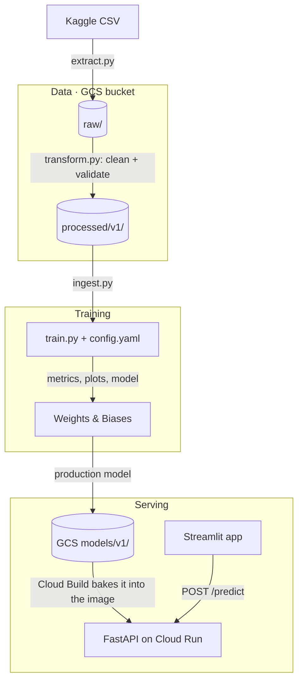

# Kickstarter Launch Checker

Predicts whether a Kickstarter campaign will reach its funding goal using only
information available on launch day, and shows how the goal amount changes the
odds.

> Module Project 3 (Data/ML Engineering), AIPI 510, Duke University.

**Live app:** https://aipi-510-kickstarter-launch-checker.streamlit.app · **API:** https://kickstarter-api-zcqiii5fia-ue.a.run.app ([interactive docs](https://kickstarter-api-zcqiii5fia-ue.a.run.app/docs))

> Both services sleep when idle, so the first visit can take up to ~30 seconds to wake up. If the app says the API is waking up, wait a moment and try again.

**Contents:** [Overview](#project-overview-and-goals) · [Architecture](#architecture) · [Dataset](#dataset) · [Model](#model-and-evaluation) · [Cloud services](#cloud-services) · [Setup](#setup) · [Usage](#usage) · [Limitations and ethics](#limitations-and-ethics) · [Deliverables](#assignment-deliverables) · [Team](#team)

## Project overview and goals

Most Kickstarter campaigns don't reach their goal, and creators make the
biggest decisions (how much to ask for, how long to run, which category to
launch in) before a single backer arrives. This project asks: **given only
what a creator knows on launch day, how likely is a campaign to get funded?**

- **Task:** binary classification. Target: `success` (1 = reached its goal, 0 = failed).
- **Inputs:** main category, subcategory, funding goal (USD), campaign length,
  country, launch month and weekday, and the campaign title.
- **Metric:** ROC-AUC (plus precision and recall at a 0.5 threshold).
- **Product:** a web app where a creator enters their campaign and sees the
  predicted chance of success, plus a what-if chart of how the odds change
  with the funding goal.

The focus is the engineering, not the model: a reproducible, config-driven
pipeline from cloud-hosted data to a deployed API and a public front-end,
with experiment tracking, containers, CI and reviewed pull requests throughout.

## Architecture



1. **Data:** the raw Kaggle CSV is stored untouched in `raw/`. A transform
   step cleans and validates it and writes a versioned Parquet snapshot to
   `processed/v1/`. Versions are never overwritten.
2. **Training:** `src/train.py` loads a data version, splits it, trains the
   model set in `config.yaml`, and logs config, data version, git commit,
   metrics, plots and the model artifact to Weights & Biases.
3. **Serving:** the production model is copied to `models/v1/` in the bucket.
   Cloud Build bakes it into the API's Docker image, and the image runs on
   Cloud Run. `/health` reports which model version is live.
4. **Front-end:** a Streamlit app calls the API and shows the result.

Design decisions:

- **One shared contract.** `src/schema.py` defines the input fields once. The
  API, the training pipeline, the front-end and the tests all use it, so
  feature names can't drift apart.
- **Features live inside the model.** Encoding and feature engineering are part
  of the saved scikit-learn `Pipeline`, so serving computes exactly what
  training did (no training/serving skew).
- **Leakage is excluded by design.** Post-launch columns (backers, amount
  pledged) are kept in the data only for a labeled demo run; they can't be
  sent to the API, and the training script refuses to promote a model that uses them.
- **Least privilege.** The API runs as a service account that can only write
  logs; the bucket is private; no service-account key files exist.

## Dataset

[Kickstarter Projects](https://www.kaggle.com/datasets/kemical/kickstarter-projects) (Kaggle),
about 380k campaigns launched 2009 to 2018.

> **TODO (Mihir):** columns kept and why · cleaning rules (states kept, invalid
> dates/countries dropped, ...) · final row count and success rate from
> `processed/v1/_meta.json` · how leaky post-launch columns are handled · the
> data quality checks.

## Model and evaluation

| Run | Model | Features | Val ROC-AUC | Test ROC-AUC |
| --- | --- | --- | --- | --- |
| Baseline | Logistic regression | Launch-day only | 0.7290 | 0.7289 |
| **Production (`kickstarter-model:v1`)** | **XGBoost** | **Launch-day only** | **0.7522** | **0.7530** |
| Leakage demo (never deployed) | XGBoost | + backers, pledged amount | 1.0000 | 1.0000 |

The production model was selected on validation ROC-AUC; the test set was used
only to report the final number. The leakage demo shows that post-launch
columns give the answer away, which is why they're excluded from the served model.

> **TODO (Mihir):** feature engineering (one-hot categories/month/weekday, log
> goal, title features) · model settings · W&B screenshots in `docs/images/` ·
> link to the W&B project if it's public.

### How to train

> **TODO (Mihir):** `wandb login` · `python -m src.train` · `--promote` and
> `--no-wandb` · the experiment switches in `config.yaml` (`model.type`,
> `features.include_leaky`) · publishing the production model to
> `gs://kickstarter-checker-nw-data/models/<version>/`.

## Cloud services

| Service | What we use it for | Details |
| --- | --- | --- |
| Google Cloud Storage | Data and model storage | Private bucket `kickstarter-checker-nw-data` with object versioning: `raw/`, `processed/v1/`, `models/v1/` |
| Google Cloud Build | Building the API image | Builds `linux/amd64` images and bakes in the production model ([cloudbuild.yaml](cloudbuild.yaml)) |
| Google Artifact Registry | Storing Docker images | Repo `kickstarter` in `us-east1`; images tagged with the git commit |
| Google Cloud Run | Hosting the API | Service `kickstarter-api`: public, scales 0 to 2 instances, runs as a least-privilege service account |
| Weights & Biases | Experiment tracking and model registry | Project `kickstarter-launch-checker`; the `production` alias marks the served model |
| Streamlit Community Cloud | Hosting the front-end | Deployed from `main`; redeploys on every merge |
| GitHub Actions | CI | Lint, format check, tests, and a Docker build with a health check on every PR |

One-time cloud setup: [docs/cloud-setup.md](docs/cloud-setup.md). Deployment: [docs/deploy.md](docs/deploy.md).

## Setup

Requires **Python 3.11** (any 3.11.x; other versions may fail to install the
pinned packages). On macOS, XGBoost also needs OpenMP: `brew install libomp`.

```bash
git clone https://github.com/gitnic-duke/aipi-510-kickstarter-launch-checker.git
cd aipi-510-kickstarter-launch-checker
python3.11 -m venv .venv
source .venv/bin/activate
pip install -r requirements-dev.txt
cp .env.example .env   # then fill in values
```

For anything that touches the cloud (data scripts, training, deploying), also
sign in with the [gcloud CLI](https://cloud.google.com/sdk/docs/install):

```bash
gcloud auth login
gcloud auth application-default login   # lets the Python code read and write the bucket
gcloud config set project kickstarter-checker-nw
```

## Usage

### Reproduce the pipeline end to end

```bash
# 1. Upload the raw Kaggle CSV to raw/ (never overwritten)
python -m src.data.extract --csv data/raw/ks-projects-201801.csv
# 2. Clean, validate and publish processed/v1/
python -m src.data.transform
# 3. Train and log to W&B (see "How to train")
python -m src.train
# 4. Deploy the API with the production model
./scripts/deploy_api.sh
```

### Run the API locally

```bash
python -m scripts.make_dummy_model          # placeholder model -> models/model.joblib
uvicorn src.api.main:app --reload --port 8000
```

To run the real model instead, download it and point the API at it:

```bash
mkdir -p model-artifact
gcloud storage cp gs://kickstarter-checker-nw-data/models/v1/model.joblib model-artifact/model.joblib
MODEL_PATH=model-artifact/model.joblib MODEL_VERSION=v1 uvicorn src.api.main:app --port 8000
```

Then open http://localhost:8000/docs for interactive docs, or use curl:

```bash
curl -s localhost:8000/health
curl -s -X POST localhost:8000/predict \
  -H "Content-Type: application/json" -d @scripts/sample_request.json
```

`/predict` takes a batch (`{"instances": [...]}`, 1 to 100 items) and returns one
success probability per item, in order. Bad input gets a 422 explaining what's wrong.

### Run the tests

```bash
pytest -v                               # API, schema, data cleaning, training, front-end helpers
ruff check . && ruff format --check .   # lint and formatting
```

CI runs the same checks, plus a Docker build and health check, on every pull request.

### Run the front-end locally

```bash
pip install -r frontend/requirements.txt
streamlit run frontend/app.py
# point it at a local API instead: API_URL=http://localhost:8000 streamlit run frontend/app.py
```

### Build and run with Docker

One image, two entry points (`serve` and `train`):

```bash
docker build -t kickstarter-api .
docker run --rm -p 8080:8080 kickstarter-api      # serves the API on port 8080
curl -s localhost:8080/health
```

A plain local build uses the placeholder model; deployed images have the
production model baked in (see [docs/deploy.md](docs/deploy.md#updating-the-model-task-t15)).

### Deploy to the cloud

```bash
./scripts/deploy_api.sh   # Cloud Build -> Artifact Registry -> Cloud Run; verifies /health
```

The front-end redeploys automatically from `main`. Details, rollback and
troubleshooting: [docs/deploy.md](docs/deploy.md).

## Monitoring

> **TODO (Mihir, T17):** what the API logs for each prediction and how to view
> it (`gcloud run services logs read kickstarter-api --region us-east1`).

## Limitations and ethics

- **Old data.** The data covers 2009 to 2018. Crowdfunding has changed since
  then (platform rules, backer behavior, the economy), so predictions for
  today's campaigns may be off: a textbook case of data drift.
- **Launch-day information only.** Success depends heavily on things the
  model never sees: the campaign video, rewards, marketing, and the creator's
  existing audience. Treat a prediction as a rough baseline, not a forecast.
- **The what-if chart shows association, not cause.** Lower goals are
  associated with higher success in the data, but lowering your goal won't
  necessarily raise your odds by the amount shown. Campaigns with small goals
  may differ in other ways too.
- **Uneven accuracy.** Categories and countries with few campaigns, and the
  US-heavy data, mean the model is likely less reliable for under-represented
  groups. We haven't measured performance per group.
- **Risk of over-reliance.** A low score could discourage a viable project,
  and a high one could create false confidence. If a platform or investor used
  scores like this to gatekeep, those biases could compound. The app labels
  results as a rough guide.
- **Leakage.** A model using post-launch data scored a "perfect" 1.0. We
  excluded those columns, which is why the honest model scores about 0.75.
- **Privacy and security.** The data is public campaign metadata with no
  personal information. The API is public and unauthenticated; batches are
  capped at 100 items and the service at 2 instances to limit abuse and cost,
  but there is no rate limiting.

### Future work

- Prediction logging and drift monitoring (e.g. Population Stability Index on live inputs)
- Separate serving dependencies from training ones for a smaller API image
- Text features from the title and description (e.g. TF-IDF)
- A time-based train/test split to measure performance on newer campaigns
- Per-group evaluation and probability calibration
- Authentication and rate limiting on the API

## Assignment deliverables

| Requirement | Where |
| --- | --- |
| Code for preprocessing, training, serving, deployment | `src/data/`, `src/train.py`, `src/api/`, `scripts/deploy_api.sh`, `cloudbuild.yaml` |
| `config.yaml` | [config.yaml](config.yaml) |
| `requirements.txt` | [requirements.txt](requirements.txt) (pinned), plus `requirements-dev.txt` and `frontend/requirements.txt` |
| Dockerfile that runs the project | [Dockerfile](Dockerfile): `serve` and `train` entry points |
| Docs: train, build/test API locally, deploy | [How to train](#how-to-train), [Usage](#usage), [docs/deploy.md](docs/deploy.md) |
| Experiment tracking | Weights & Biases ([Model and evaluation](#model-and-evaluation)) |
| Branches and pull requests | Every change merged through reviewed PRs; see [CONTRIBUTING.md](CONTRIBUTING.md) |
| Data in cloud storage, accessed programmatically | GCS bucket; `src/data/extract.py`, `transform.py`, `ingest.py` |
| Deployed `/predict` API | https://kickstarter-api-zcqiii5fia-ue.a.run.app/docs |
| Public front-end | https://aipi-510-kickstarter-launch-checker.streamlit.app |

## Repository structure

```
src/
  schema.py           shared input/output contract
  config.py           loads config.yaml
  data/               extract.py, transform.py, ingest.py, gcs.py
  features.py         feature engineering + model inside one Pipeline
  train.py            training, evaluation, W&B logging
  api/main.py         FastAPI service (/health, /predict)
frontend/             Streamlit app, helpers, category values
scripts/              GCP setup, deploy, placeholder model, sample request
tests/                pytest suite (run in CI)
docs/                 cloud setup and deploy guides
config.yaml           pipeline configuration
Dockerfile            one image for training and serving
cloudbuild.yaml       Cloud Build: fetch model, build image
.github/workflows/    CI
```

## Team

- **Mihir** (`mihirkos9`): data pipeline, training, experiment tracking
- **Nick** (`gitnic-duke`): API, Docker, CI, cloud deployment, front-end

> **TODO:** full names.

See [CONTRIBUTING.md](CONTRIBUTING.md) for the branch, commit and PR workflow.
